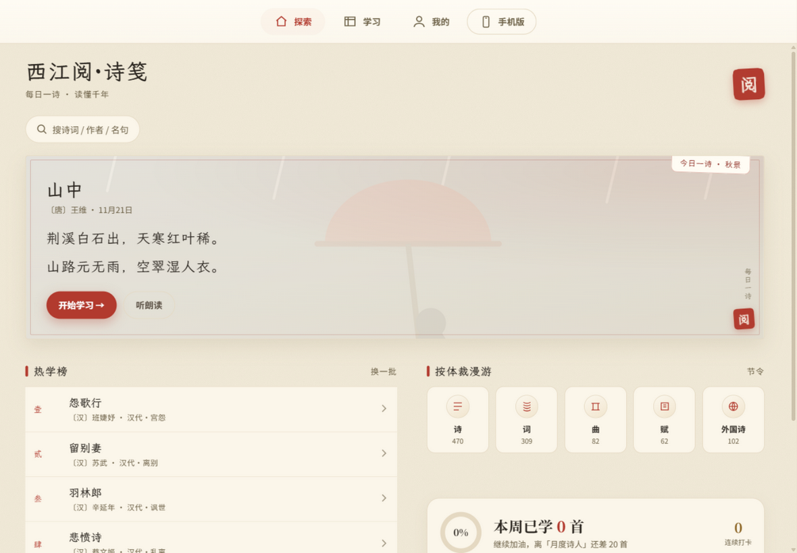
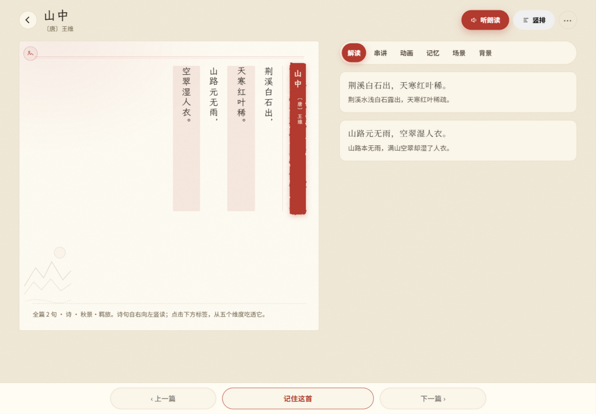
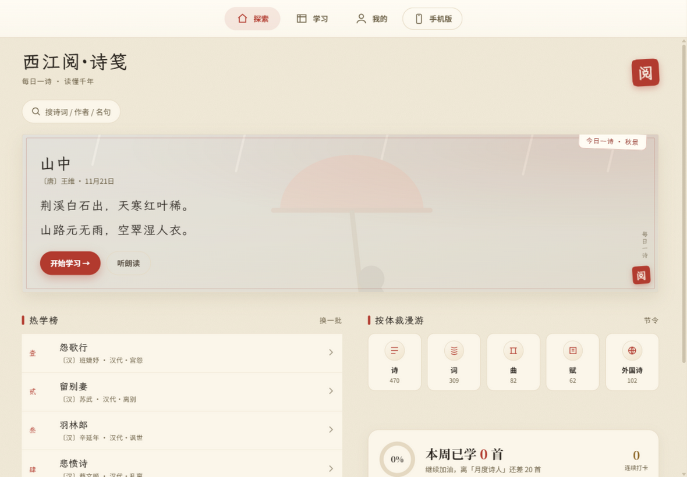
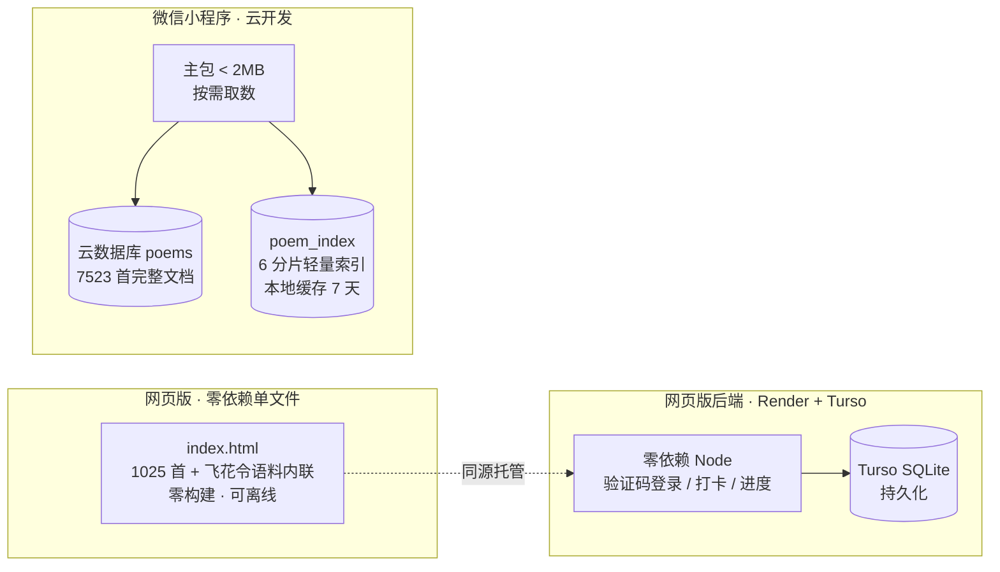

<div align="center">

# 西江阅 · 诗笺

**每日一诗 · 读懂千年 —— 一座会提醒你温故的随身诗词馆**

[在线体验](https://kumu314.github.io/xijiangyue/) · [微信小程序（1.0.2 审核中）](#-架构与部署) · [内容生产规格](out/content_production/SPEC.md)

[](https://kumu314.github.io/xijiangyue/)
[](https://kumu314.github.io/xijiangyue/)
[](#-记忆闭环)
[](#-架构与部署)
[](LICENSE)

<table>
<tr>
<td width="33%" align="center"><b>探索 · 每日一诗</b><br></td>
<td width="33%" align="center"><b>精读 · 竖排手卷</b><br></td>
<td width="33%" align="center"><b>学习 · 打卡与温故</b><br></td>
</tr>
</table>

*纸墨质感 · 朱丝栏竖排手卷 · 霞鹜文楷 · 每一枚完成项都钤一枚朱砂小印*

</div>

---

## 为什么是「诗笺」

市面上的诗词应用要么是查词典，要么是信息流。**西江阅赌的是另一件事：一个人真的想把诗背下来、留下来。**

所以它的核心不是「更多」，而是「记得住」——逐句读懂、画面化记忆、间隔温故、生活里用得上。整个产品围绕这条记忆闭环生长，视觉上则刻意做成一叠纸：竖排、界行、朱砂印，读诗像翻一册手卷。

## 记忆闭环

> 设计依据是三条朴素的学习科学：**间隔重复**（遗忘先快后慢，在临界点轻唤醒）、**主动回忆**（遮字自测远胜反复重读）、**双重编码**（画面比文字牢）。

| 机制 | 做法 |
|---|---|
| **背诵模式** | 遮字四级递减（末三字 → 后半句 → 只留首字 → 全遮），点按逐字揭示，通背一遍才算「背过」并自动入温故队列 |
| **温故桶制 SRS** | 隔 1 / 3 / 7 / 14 / 30 天各唤醒一次（8 句以上长诗升桶更慢）；到期队列每日上限 10 首、超期自动降档防积压、连续三次回炉标记「拗口」温和降频 |
| **五项打卡** | 读 / 观（意象动画）/ 知（背景故事）/ 记（背诵）/ 温（温故），配「五清」植物（梅兰竹菊松）——未打卡枯灰下垂，打卡即本色直立 |
| **双连击 + 热力图** | 打卡连击与全勤连击分轨结算，GitHub 风格热力图回看一年坚持 |
| **口径防灌水** | 温故不计入「已学」与满勤（单独 reviewCount）——努力与运气分开记账 |

## 内容纵深

内容不是爬来的，是**逐篇生产并过闸**的：

| 内容面 | 覆盖（线上实测 2026-11-21） |
|---|---|
| 收录诗目 | **1025 首**（诗 470 · 词 309 · 曲 82 · 赋 62 · 外国诗 102；精读 258 / 拓展 767） |
| 逐句白话译文 | **1014 / 1025**（6142 句逐句对译） |
| 串讲 | 全覆盖，其中 **755 篇深度串讲**（起承转合 · 意象 → 情感 → 主旨） |
| 记忆技巧卡 | **978 首**（画面联想 / 结构抓手 / 意象锚点 / 名句锚点，逐首定制） |
| 使用场景 + 故事背景 + 意象动画 | 全覆盖 |
| 飞花令语料 | 约 7 万条诗句片段，四款小游戏（飞花令 / 接龙 / 背一背 / 考一考） |

**内容质量管线**（这套比内容本身更能说明项目认真程度）：

- 逐批 30 首生产，机械自检 15 项全量复算（引文须与原诗逐字命中、字数口径、禁套话开头）；
- **n=12 跨篇反模板主判据** + 注入自测（判据自己必须先证明自己能抓到坏样本）；
- 译文「实质改写率 ≥90%」机械硬闸（照抄 / 加虚词 / 微改一律不算改写）；
- 全库近重复扫描去重（4-gram 倒排，已知 70 篇基线只报新候选）。

## 视觉与排版

- **竖排手卷**：正文 `writing-mode` 竖排 + 朱丝栏 + 朱砂题签，译文横排对照；一键竖排 / 横排切换；
- **霞鹜文楷**（LXGW WenKai）标题诗句，异步加载、断网楷体兜底；
- **意象场景动画**：月浮 / 雨落 / 花开等九类轻量 CSS 动效，英雄区低透明度衬景，`prefers-reduced-motion` 全量降级；
- 完成项**钤朱砂单字印**（读 / 观 / 知 / 记 / 温），全勤日收印入印谱册页。

## 架构与部署



- **网页版**：单一 `index.html`，零依赖、零构建、可离线双击打开；GitHub Pages 发布（发版与合码已解耦）。
- **微信小程序**：数据迁出主包（主包 < 2MB），云数据库 `poems` 按需取单首 + 6 分片轻量索引秒开列表；**7523 首**全量库已导入，1.0.2 审核中。
- **双端口径一致**：打卡 / 温故 / 连击的判定逻辑逐条对齐（温故不计满勤、单独计数），一套拍板两端生效。

## 快速开始

**在线用**：直接打开 [kumu314.github.io/xijiangyue](https://kumu314.github.io/xijiangyue/)

**本地跑**：

```bash
git clone https://github.com/kumu314/xijiangyue.git
cd xijiangyue
python -m http.server 8080   # 或直接双击 index.html，无任何依赖
```

**微信小程序**：微信开发者工具导入 `shiyun-miniprogram/`（源码仓库另见），开通云开发后按 `docs/` 操作卡导入 `poems` 集合与 `poem_index` 索引分片。

## 目录一览

```
xijiangyue/
├── index.html            # 网页版全部：诗库 + 逻辑 + 样式（单文件）
├── backend/              # 网页版后端：零依赖 Node（登录 / 打卡 / 进度，Turso 持久化）
├── docs/                 # 设计稿 / 调研 / 操作书（含内容生产规格 SPEC）
├── out/content_production/  # 内容生产台账：批次 / LEDGER / 门闸工具
├── tests/                # 断言与回归脚本
└── shiyun-miniprogram/   # 微信小程序（源码仓库另见）
```

## 近期里程碑

- **2026-11** 云开发解耦完成，小程序 7523 首全量库导入就绪，1.0.2 提审；发版与合码解耦
- **2026-10** 内容生产六功能面全绿（串讲 / 译文 / 记忆卡 / 场景 / 故事 / 动画），质量门闸体系成型
- **2026-10** 温故桶制 SRS 双端上线；背诵模式（遮字四级 + 首字诀 + 通背入队）网页版落地
- **2026-10** 外国诗 43 首专项核验修复（作者错置 / 意译改写 / 原文补录）

## 数据来源与版权

- 诗词正文以**公有领域**古典文献为主（诗经、全唐诗、全宋词等），主要来自开源数据集 [chinese-poetry](https://github.com/chinese-poetry/chinese-poetry)。
- **逐句译文、串讲、记忆技巧卡、场景、故事背景、视觉与动效**为本项目原创内容，保留权利；引用请注明出处，商用请先联系作者。
- 字体：[霞鹜文楷 LXGW WenKai](https://github.com/lxgw/LxgwWenKai)（SIL OFL）。

## License

[MIT](LICENSE) © 2026 枯木 (kumu314)
